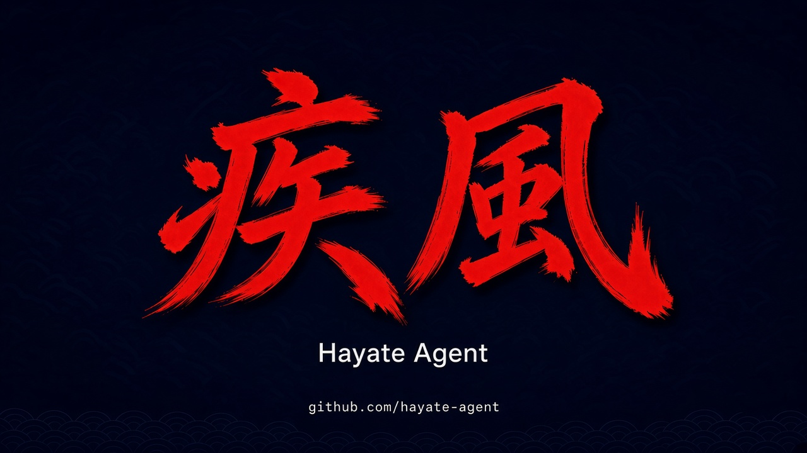

# Hayate Agent



A persistent AI agent for your terminal and messaging gateways. Use it to work on
code interactively, or keep it running to handle conversations, scheduled tasks
and longer-term goals.

Hayate Agent owns scheduling, queues and message delivery. PI is the current model
and tool runtime; you do not need a separate PI installation to install Hayate Agent.
Existing PI provider configuration can be reused.

## Naming and compatibility

**Hayate Agent** is the product display name. The executable and npm package
remain `vanillacore-harness`; existing commands, `~/.vanillacore-harness`,
`harness.yaml`, `VANILLACORE_HARNESS_HOME`, import names, API/storage identifiers
and deployment/image identifiers stay compatible. No state migration is needed.
“Harness” may still describe the runtime architecture or a technical identifier;
it is not a second product name.

Branding does not replace configured agent keys, SOUL/VOICE identities or other
agents' personas. Updated templates apply only to newly created files; existing
files are never overwritten. Updating source or building does not activate a
running installation: install the reviewed version and restart through your
normal deployment process. Cross-repository overlays/plugins may retain their
own display text until separately updated.

## Repositories

- [hayate-agent/core](https://github.com/hayate-agent/core) — product source and documentation.
- [hayate-agent/plugins](https://github.com/hayate-agent/plugins) — independently versioned plugin adapters.
- [hayate-agent/deployments](https://github.com/hayate-agent/deployments) — canonical deployment repository.

These are the canonical repository addresses, not a migration of existing runtime
remotes, plugin source pins or deployment configuration. The deployments address
does not establish a directory layout or a mapping from older overlay/base repositories.
Core's local deployment examples remain in `deploy/`.

Repository publication is still pending: the GitHub repositories are currently
empty. The installation commands below require Core's source to be published on
`main`; until then, keep using an existing verified checkout rather than an empty
clone. Existing installations do not need their remotes or configuration changed.

## Install and start

You need **Git and Node.js with npm**. Node **24.22.1 LTS** is recommended;
the native CLI requires at least Node 22.19.0. Linux, macOS and Windows through
WSL2 are supported.

```sh
git clone https://github.com/hayate-agent/core.git "$HOME/vanillacore-harness"
cd "$HOME/vanillacore-harness"
npm ci
npm install --global --prefix "$HOME/.local" .
export PATH="$HOME/.local/bin:$PATH"

cd /path/to/your/project
vanillacore-harness
```

Keep the checkout: this local installation links to it. Add the PATH line to your
shell profile to make the command available in future terminals. No `sudo` or
initialization wizard is required. `npm ci` also builds the CLI.

In the terminal interface, use **`/login`** to connect a supported provider and
**`/model`** to select a model. Custom providers use PI's `models.json`; see
[configuration](docs/configuration.md). Existing PI settings in `~/.pi/agent`
are reused, so changes there can affect other PI-based applications.

**Your first session:** ask the agent to inspect your project, use `/help` to
browse commands, and `/sessions` or `/resume` to return to an earlier conversation.
Each interactive launch starts a fresh conversation scoped to the current workspace.

For Docker Compose, Kubernetes and background services, see
[installation](docs/installation.md). Native Windows outside WSL2 is not supported.

## What you can do

| Capability | What it means in practice |
|---|---|
| **Interactive coding** | A fullscreen terminal interface with streaming answers, tool activity and a fixed input area. Configure which tools the model may use. |
| **Persistent conversations** | Keep history across restarts, name sessions, and explicitly resume work. Native PI session storage is the default. |
| **Always-on work** | Run heartbeats, recurring loops, cron jobs and standing goals without keeping a terminal open. |
| **Parallel conversations** | Separate conversations can run concurrently; each conversation processes its own queue in order. |
| **Matrix gateway** | Talk to the same Hayate Agent through DMs or rooms, with allowlists, mention rules, threads and approval handling. |
| **HTTP run API** | Submit runs programmatically and stream progress through a Hermes-compatible API. AgentOS integration is optional. |
| **Identity and skills** | Use `SOUL.md` for identity, `VOICE.md` for tone, and discoverable skills for reusable procedures. |
| **Trusted plugins** | Add commands, channels, tools, terminal panels and interactive dialogs through local ESM modules. Storage and manual compaction also have extension points. |
| **Optional MCP** | Enable PI-backed MCP integration when needed; it is not a required service. |

Approvals are **off by default**. You can enable manual approval for selected
tools. Plugins are trusted process code, not sandboxed extensions.

## Everyday commands

- **Sessions:** `/new`, `/title`, `/sessions`, `/resume`, `/compact`.
- **While working:** `/stop`, `/queue`, `/steer`, `/busy`.
- **Ongoing tasks:** `/goal`, `/heartbeat`, `/loop`, `/cron`. See [Cron reports](docs/cron-reports.md) for internal/user audiences and retained follow-through.
- **Configuration:** `/model`, `/reasoning`, `/personality`, `/skills`.
- **Discoverability:** `/help`, `/status`, `/harness` (bundled development guide).

Not every command is available on every channel. Use `/help` in your current
interface rather than memorizing the full command list.

## Run as a gateway

```sh
vanillacore-harness run
```

This starts the same Hayate Agent without the interactive TUI. Configure Matrix with
`MATRIX_HOMESERVER` and either `MATRIX_ACCESS_TOKEN` or password-login settings.
Set `MATRIX_ALLOWED_USERS` and the room/approval policy before connecting it to
other people. A configured model provider is required to answer messages.

The HTTP API is enabled with `API_SERVER_KEY`; supply secrets through your runtime
environment, not source control. Use a supervisor or container deployment for an
always-on service. `/restart` drains work and exits with status 75; the supervisor
is responsible for starting it again.

See [configuration](docs/configuration.md) for settings and
[operations](docs/operations.md) for durable delivery, retries, memory pressure
and shutdown behavior.

## Configuration and data

Hayate Agent state defaults to **`~/.vanillacore-harness`**. Use
`VANILLACORE_HARNESS_HOME` for a separate agent home. A minimal optional
`harness.yaml` looks like this:

```yaml
agent: example-agent
timezone: Europe/Berlin
loop:
  busyMode: queue
  drainSeconds: 60
```

Model/provider credentials and PI settings live separately in `~/.pi/agent`
(or `PI_CODING_AGENT_DIR`). Persistent installations need to retain both locations.
`init` creates missing starter files; `doctor` checks local configuration. Neither
is required for normal interactive use.

The container runs as UID/GID 1000 and includes Chromium runtime libraries,
Python virtual environments and native build tools. Agents can install their own
CLI tools in writable persistent storage; no particular browser CLI is required.
See [browser tooling](docs/browser-tools.md). Kubernetes examples use immutable
image digests and expect private configuration and secrets to be supplied separately.

## Current boundaries

- **Matrix E2EE is not yet supported.** Do not use encrypted rooms expecting the
  current released adapter to decrypt or answer them.
- **Slack and Telegram adapters are not included.** The plugin channel interface
  supports additional transports, but does not implement them automatically.
- A Web UI and automatic activation/rollback of agent-built runtime versions are
  not shipped features.
- Matrix supports optional [gateway progress and status reactions](docs/gateway-progress.md),
  with global defaults and per-gateway overrides. A generic secret-manager context
  is still under development.
- Durable queues reduce lost work, but crash recovery is **at least once**, not
  exactly once. External tool effects may be repeated after a crash.

## Documentation

- [Installation](docs/installation.md) — native, Compose and Kubernetes
- [Configuration](docs/configuration.md) — models, tools, identity and access settings
- [Sessions](docs/sessions.md) — resume, storage providers and compaction
- [MCP](docs/mcp.md) · [Plugins](docs/plugins.md) — integrations and extension APIs
- [Operations](docs/operations.md) — recovery and service operation
- [Self-development](docs/self-development.md) · [Development guide](docs/development.md)

## Contribute

Use a user-owned checkout, make changes on a feature branch, and run:

```sh
npm ci
npm run typecheck
npm test
npm run build
```

Submit changes through a pull request. Keep deployment identities, internal
endpoints and credentials out of the public repository.

## License

Apache License 2.0. See [LICENSE](LICENSE).
